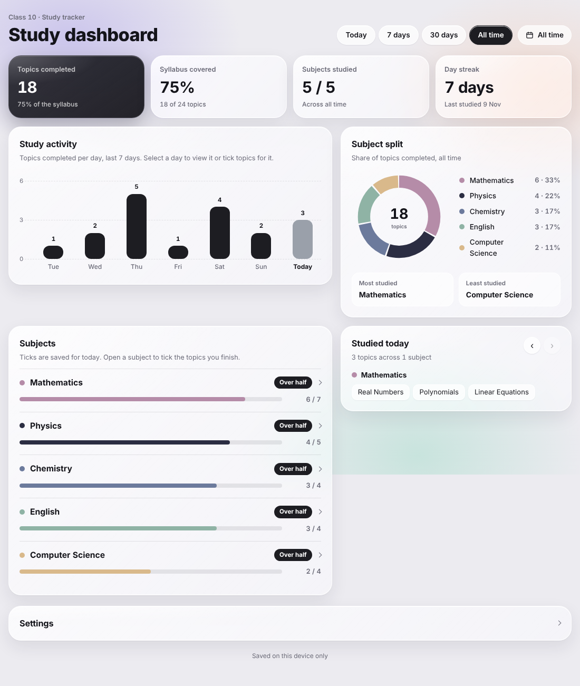
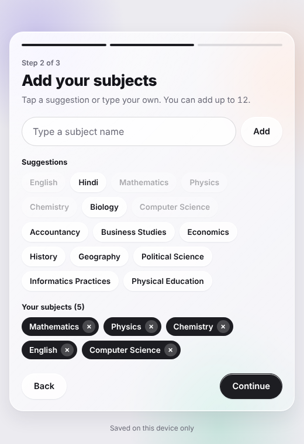
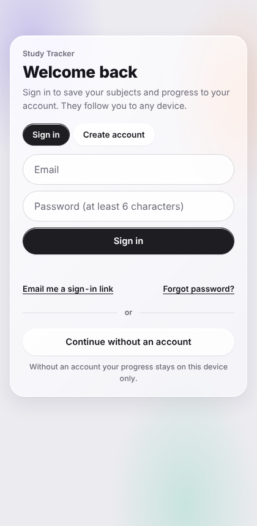

# Study Tracker

A simple, clean study tracker that works for any class, subject list and syllabus. You tell it your class, your subjects and your chapters. Then you tick topics as you finish them and watch your progress fill up. Sign in to keep your progress in the cloud and open it on any device.

**Live demo:** https://udit0665.github.io/study-tracker/

## What it does

- **Setup in three steps:** your class or course, your subjects, then your chapters for each subject. Nothing is preset, so it fits any board, school or college.
- **Progress per subject:** every subject has its own progress bar that fills as you tick chapters.
- **Daily log:** see what you studied today (or any earlier day) and which topics you covered.
- **Study activity:** a bar chart of topics completed over the last 7 days.
- **Subject split:** a donut chart that shows which subjects get the most and least of your time.
- **Stats:** topics completed, syllabus covered, subjects studied and your day streak, with Today, 7 days, 30 days and All time views.
- **Accounts and cloud sync:** sign in with email and password, a magic link or Google. Your data is saved to your account and follows you across devices.
- **Guest mode:** or skip the account and keep everything on the device.
- **Settings:** rename your class, add, rename or remove subjects, sign out, or start over.
- **Installable:** works as a home screen app on a phone.

  
  

## How to use it

1. Open the page and sign in, or tap **Continue without an account**.
2. Enter your class (for example Class 10, Grade 12 or B.Com Year 1).
3. Add your subjects. Tap a suggestion or type your own.
4. Paste or type your chapters for each subject, one per line. You can skip this and add chapters later.
5. Open a subject and tick each topic when you finish it. Use the arrows in "Studied today" to log a day you missed.

If you start in guest mode and sign in later, your guest progress is uploaded to the new account. If the account already has saved progress, the saved progress is used.

## How accounts work

- **Sign in:** [Supabase Auth](https://supabase.com/docs/guides/auth) handles email and password, magic links and Google. The Google button only appears once Google is switched on in your Supabase project.
- **Database:** one Postgres table, `study_state`, with one row per user. The row holds that user's whole tracker (class, subjects, chapters and ticks) as JSON. The table is created by `schema.sql`.
- **Privacy:** row level security is on. Each policy checks `auth.uid() = user_id`, so a signed-in user can only read and write their own row, and signed-out visitors can read and write nothing.
- **Public key:** `config.js` holds the project URL and the public anon key. These are meant to be visible in the browser. Never put a `service_role` key in this repository.
- **Offline:** changes are always saved on the device first. If the cloud can't be reached, the app says so and uploads the changes on the next save, or the next time you open it.

## Set up your own backend

Use this if you fork the project and want your own users and data.

1. Create a free project at [supabase.com](https://supabase.com).
2. Open **SQL Editor**, paste the contents of `schema.sql` and run it.
3. Open **Project Settings > API**. Copy the project URL and the anon public key into `config.js`.
4. Open **Authentication > URL Configuration**. Set **Site URL** to your live address (for example `https://your-name.github.io/study-tracker/`) and add the same address under **Redirect URLs**. Without this, confirmation and magic links send people to the wrong place.
5. Open **Authentication > Providers > Email**. Supabase's built-in email sender is meant for testing and has a low hourly limit, so for a public app either connect your own email service (SMTP) under **Authentication > Emails**, or turn off **Confirm email** so sign up works without sending a message. Magic links and password resets always need working email.
6. Optional, for Google: create an OAuth client in the Google Cloud console, add the callback URL shown under **Authentication > Providers > Google**, then paste the client ID and secret there and switch the provider on.

To run without accounts, delete the `url` and `key` values in `config.js`. The app then saves on the device only.

## Run it yourself

There is no build step.

- Serve the folder with any static server, for example `python3 -m http.server`, then open `http://localhost:8000`. Sign in links need a real web address, so opening `index.html` straight from disk works only in guest mode.
- To use it on GitHub Pages, upload all the files to a repository, go to **Settings > Pages**, choose **Deploy from a branch**, pick `main` and `/ (root)`, and save. Your site is live at `https://<your-username>.github.io/<repository-name>/` after a minute.

## Install on a phone

Open the live page in Chrome on Android, tap the menu (three dots), then **Install app** or **Add to Home screen**.

## Files

| File | Purpose |
| --- | --- |
| `index.html` | The whole app: markup, styles and script in one file |
| `config.js` | Supabase project URL and public key |
| `schema.sql` | Database table and security rules, run once in Supabase |
| `manifest.webmanifest` | Name, colours and icons for installing the app |
| `sw.js` | Service worker that caches the app files. It never caches sign in or database requests |
| `icon-*.png`, `apple-touch-icon.png`, `favicon.png` | App icons |

## Built with

Plain HTML, CSS and JavaScript with no build tools. [supabase-js](https://github.com/supabase/supabase-js) loaded from a CDN for sign in and the database, and the Manrope font from Google Fonts. Charts are drawn with SVG.

## Ideas for later

- Export and import progress as a file
- Exam date countdown
- Mock test score tracker
- Dark mode
- Split the saved JSON into separate subject and topic tables
